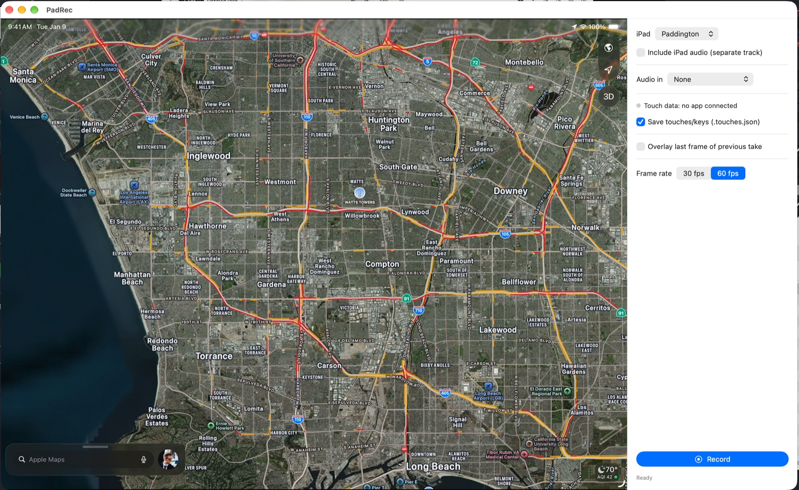
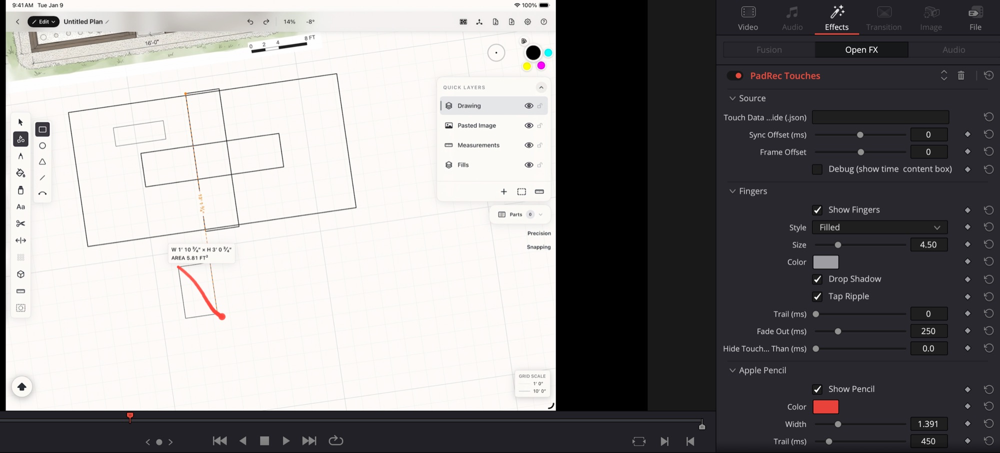

# TouchRecordKit

Record an iPad screen over USB as a clean, **constant-frame-rate H.264 MP4**, with your audio interface. Optionally capture every touch, Apple Pencil stroke and keyboard shortcut from your own app, then draw them back over the footage in DaVinci Resolve.



QuickTime can record a connected iPad too, but it writes variable-frame-rate files that Resolve and other editors play back at the wrong speed. TouchRecordKit captures the iPad the same way QuickTime does and writes a standard 30 or 60 fps file that drops straight onto a timeline.



## What's in the box

| Part | What it does | Folder |
|---|---|---|
| **TouchRecordKit.app** | Mac app. Records the iPad screen and audio, and receives touch data. | `App/` |
| **TouchRecordKit** Swift package | Add it to your iPad app. Streams touches, Pencil and keys to the Mac app. Compiled out of Release builds. | `Sources/` |
| **TouchRecordKit OFX plugin** | DaVinci Resolve effect that draws the recorded touches over the clip. | `ofx/` |

## Install

Download the latest DMG and plugin installer from [Releases](https://github.com/fform/touchrecordkit/releases), or build from source:

```sh
App/build.sh install    # -> /Applications/TouchRecordKit.app
ofx/build.sh install    # -> /Library/OFX/Plugins (asks for your password), then restart Resolve
```

Building needs Xcode 16.3 or later. The app runs on macOS 14+.

## Recording

1. Connect the iPad with a cable and unlock it. If asked, tap **Trust** on the iPad.
2. Open TouchRecordKit and pick the iPad.
3. Pick an **Audio in** device and tick the inputs you want (for example input 1 of a Volt). Selected inputs are mixed to dual-mono. **Include iPad audio** adds the iPad's own sound as a separate track.
4. Choose 30 or 60 fps and press **Record**.

Files are saved to `~/Movies` as `iPad <date>.mp4`: H.264 High profile, Rec. 709, AAC 48 kHz. If the screen doesn't change, the last frame is repeated, so the frame rate stays constant. If you rotate the iPad mid-take, the picture is letterboxed to fit.

**Overlay last frame of previous take** lays the final frame of your most recent recording over the live preview, so you can get the iPad back to the same spot before another take. The overlay only appears in the preview and is never recorded.

## Capturing touches from your app

Add the package in Xcode: **File ▸ Add Package Dependencies…** and enter

```
https://github.com/fform/touchrecordkit.git
```

Or in `Package.swift`:

```swift
.package(url: "https://github.com/fform/touchrecordkit.git", from: "1.0.0")
```

Start it once at launch:

```swift
import TouchRecordKit

@main
struct MyApp: App {
    init() { TouchRecordKit.start() }
    // ...
}
```

Add these keys to your app's Info.plist:

```xml
<key>NSLocalNetworkUsageDescription</key>
<string>Send touch data to TouchRecordKit on your Mac</string>
<key>NSBonjourServices</key>
<array><string>_touchrecordkit._tcp</string></array>
```

That's it. When the iPad and Mac are on the same network, the Mac app finds your app through Bonjour and shows **Touch data: <app>** with a green dot. Each recording then gets an `iPad <date>.touches.json` next to the MP4. If no app connects during a take, no file is written.

### Only in Debug builds

The streaming code is only compiled into **Debug** builds. In **Release** builds, `TouchRecordKit.start()` is an empty function, so you can leave the call in. Your App Store binary contains no networking or event hooks from this package. `TouchRecordKit.isCompiledIn` tells you which version you got.

To include it in a Release build, such as a TestFlight demo build, enable the package's `AlwaysOn` trait:

```swift
.package(url: "https://github.com/fform/touchrecordkit.git", from: "1.0.0", traits: ["AlwaysOn"])
```

### What it captures

- Finger touches, including coalesced 120/240 Hz samples
- Apple Pencil position, force, altitude, azimuth and roll
- Pencil and pointer hover
- Trackpad and mouse clicks
- Hardware-keyboard key down/up, including held modifiers (⌘ ⇧ ⌥ ⌃)

It hooks `UIApplication.sendEvent`, so you don't need to change any views.

### Timing

The Mac app pings your app four times a second and keeps the fastest round trip, the same idea as NTP. It uses that to convert each `UIEvent.timestamp` to the Mac's clock, then onto the video timeline, where t = 0 is the first video frame. The app shows the current sync accuracy, which is usually under a few milliseconds.

The video itself reaches the Mac slightly after the iPad screen changes, typically a few tens of milliseconds. You can correct for this with **Sync Offset** in the plugin.

## The Resolve plugin

1. Install the plugin and restart Resolve.
2. In the **Effects ▸ Open FX** library, find **TouchRecordKit ▸ TouchRecordKit Touches** and drop it on the iPad clip.
3. That's all. The plugin asks Resolve for the clip's media file and loads the `.touches.json` next to it. Keep the MP4 and JSON together with matching names. To use a different file, set **Touch Data Override**.

Timing follows the source media frame, so trimming, moving or retiming the clip on the timeline doesn't break sync. If touches land slightly before the picture changes, raise **Sync Offset**. **Debug** shows the frame, the mapped time and which file was loaded.

Appearance options:

- **Fingers:** filled dot, ring, or both. Size, color, drop shadow, tap ripple, trail length, fade out.
- **Apple Pencil:** color, width, pressure-sensitive width, trail length, tip dot, hover ring.
- **Pointer:** trackpad and mouse clicks.
- **Keys:** an on-screen key display with position, size, linger time and background opacity.

Curating what's shown:

- Every Show toggle can be keyframed, so you can turn overlays on and off through an edit.
- **Hide Touches Shorter Than** removes accidental brushes.
- **Shortcuts Only** shows only ⌘/⌃/⌥ combos. **Modifiers Only** shows only held modifiers.
- **Ignore Keys** takes a comma-separated list, for example `space, delete`.

The plugin assumes the iPad picture is aspect-fit in the frame, which is Resolve's default for a 4:3 clip on a 16:9 timeline. If you zoom or reposition the clip, apply the effect on the Color page or inside a compound clip, so it runs before the transform. Failures are logged to `~/Library/Logs/TouchRecordKit.log`.

## `.touches.json` format

The data is plain JSON, so you can also bring it into After Effects, Motion or your own tools.

```jsonc
{
  "format": "touchrecordkit", "version": 1,
  "video":  { "file": "iPad 2026-11-04 10.00.00.mp4", "width": 2732, "height": 2048, "fps": 60 },
  "device": { "device": "iPad", "app": "MyApp", "screen": { "w": 1366, "h": 1024, "scale": 2 } },
  "events": [
    { "type": "touch", "t": 1.2345, "id": 3, "phase": "began|moved|ended|cancelled",
      "kind": "finger|pencil|pointer", "x": 0.41, "y": 0.62,          // normalized screen, top-left origin
      "force": 1.2, "maxForce": 4.17, "altitude": 0.9, "azimuth": 0.4, "roll": 0.0, "radius": 0.02 },
    { "type": "hover", "t": 1.1, "id": 2, "phase": "began|moved|ended", "kind": "pencil|pointer", "x": 0.4, "y": 0.6 },
    { "type": "key", "t": 2.0, "phase": "down|up", "label": "S", "code": 22, "chars": "s", "modifiers": ["cmd"] },
    { "type": "screen", "t": 5.0, "w": 1024, "h": 1366, "scale": 2 },   // rotation
    { "type": "end", "t": 63.2, "syncRttMs": 3.8 }
  ]
}
```

- `t` is seconds from the first video frame. Events are nearly but not strictly in order, so sort by `t` before use.
- Key labels are `cmd`, `shift`, `option`, `control`, `capslock`, `return`, `esc`, `delete`, `tab`, `space`, `left`, `right`, `up`, `down` and `F1`–`F12`. Any other key uses its character, uppercased.

## Releasing

`scripts/release.sh` builds a universal app and plugin, signs them with your Developer ID, notarizes them, and puts a DMG and plugin installer in `dist/`. `scripts/release.sh publish` also tags `v$(cat VERSION)` and creates the GitHub release. One-time setup steps are at the top of the script.

To ship a new version, bump `VERSION`, commit, then run `scripts/release.sh publish`.

## Repository layout

```
Package.swift, Sources/TouchRecordKit/   Swift package for your iPad app
App/                                     Mac app (SwiftUI, AVFoundation, CoreMediaIO)
ofx/                                     Resolve plugin (OFX C API, CoreGraphics)
  tools/mini_host.mm                     tiny OFX host for testing renders without Resolve
scripts/release.sh                       sign, notarize and publish
```

## License

The OpenFX headers in `ofx/vendor/openfx` are BSD-licensed. See the license file in that folder.
